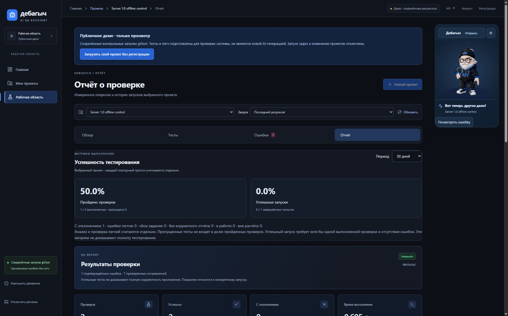
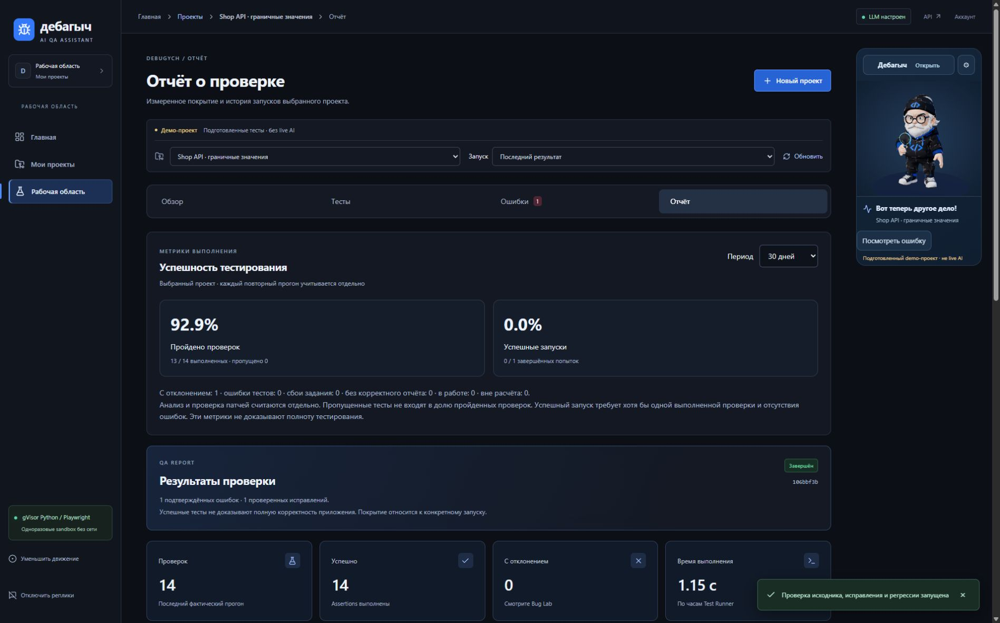
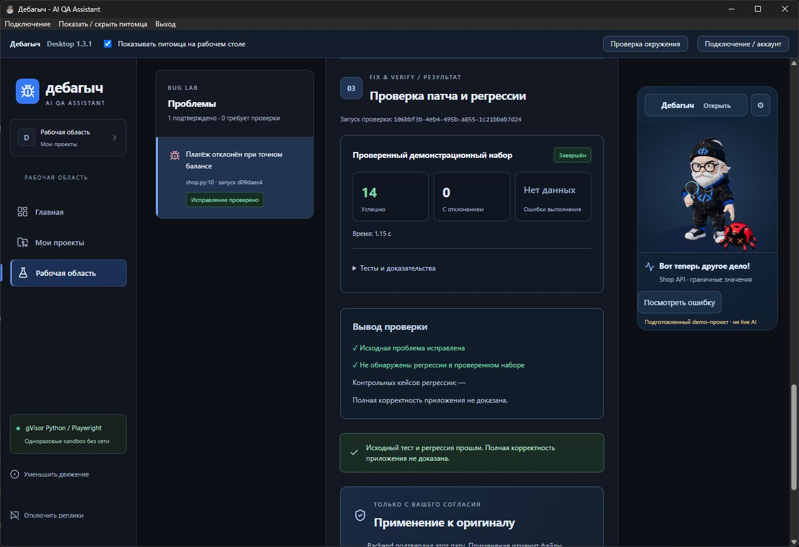
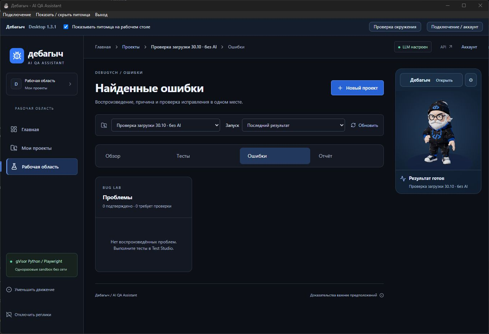
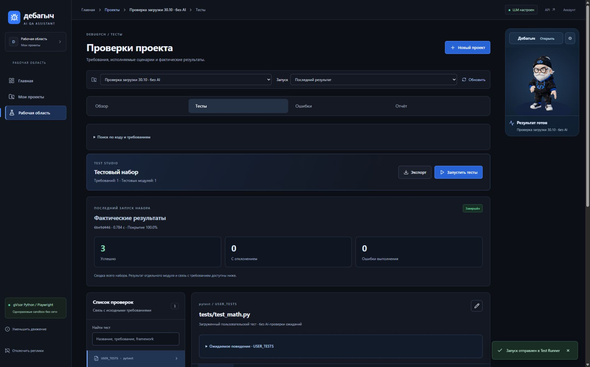
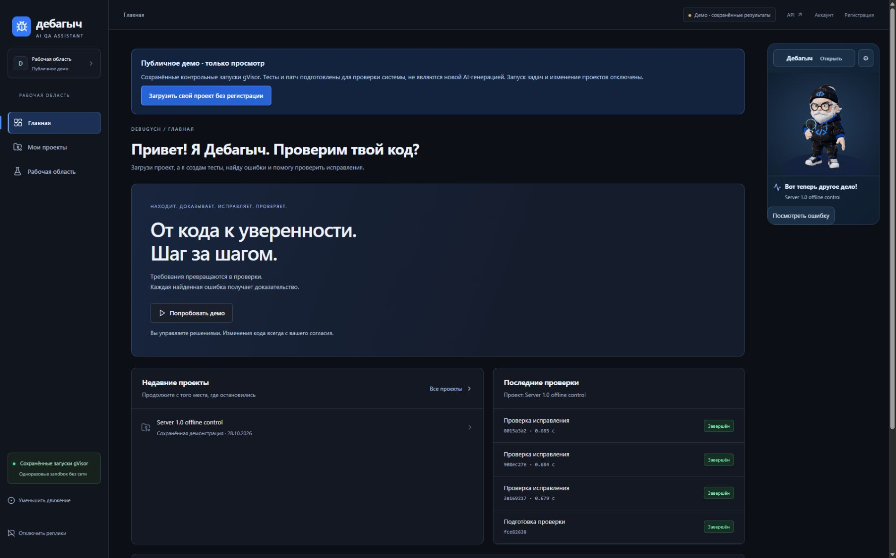

# Аудит сайта и Desktop 1.3.1

30 октября 2026. Ветка `fix/site-desktop-audit`. Проверены опубликованный HTTPS-сайт и настоящие Windows/WebView2 окна. Это новый пользовательский прогон, а не повторная публикация старых скриншотов. Платных LLM-запросов и применения патчей не было.

## Найденные и исправленные проблемы

1. Установлена устаревшая 1.2.1 со старым адресом nip.io. Сайт открывался, приложение сообщало о недоступном сервере. Установлена 1.3.1, подключён действующий sslip.io. Перед изменением сделана приватная резервная копия connection.json. Вход выполнен существующим тестовым аккаунтом жюри с разрешения пользователя; пароль не менялся и в отчёт не включён.
2. Переключение Local/Remote сбрасывало адрес на старый nip.io. Shell теперь помнит настроенный HTTPS-сервер; новый адрес по умолчанию sslip.io. Добавлена проверка сохранения произвольного адреса, без смены аккаунта и без LLM.
3. Готовый демопатч ошибочно занимал слот фонового запуска на 10 минут. Шлюз сохранял ID Fix как ID Run, затем получал 404 на /runs/{fix-id} и блокировал Verify. Синхронный Fix различается по операции, связи с исходной ошибкой и полю diff. Настоящие queued/running задания продолжают блокировать параллельный запуск. Новый HTTP-сценарий сначала воспроизвёл 429 вместо 202, после исправления прошёл.
4. Смена проекта оставляла в React ссылку на Bug Proof прежнего проекта. Сброшен ResultTarget при явном выборе другого проекта. Native-очистка выбора больше не вызывает автоматический выбор первого проекта. Ошибочная прямая ссылка по-прежнему отклоняется, другой результат вместо неё не подставляется.
5. Публичный снимок называл общий проект личным и показывал неработающий мастер загрузки. Теперь он отмечен как сохранённая демонстрация; мастер и лишние кнопки создания скрыты. Сохраняется явная кнопка перехода к гостевой загрузке. Вход в демо из списка проектов работает.
6. Публичный Bug Lab предлагал настроить LLM_API_KEY, а сохранённый offline-патч называл AI-предложением. Для режима просмотра эти сообщения заменены корректной подписью сохранённого предложения. Серверные ограничения записи сохранены. Экспорт, недоступный публичному снимку, не предлагается как рабочее действие.
7. Карточке успешности в Reports не хватало отступов. Добавлены 24 px на обычном экране и 16 px на мобильном; проверена ширина 390 px без горизонтального переполнения.
8. Для импортированных пользовательских тестов служебная метка USER_TESTS выглядела как измеренное покрытие документа требований. В отчёте теперь явно написано, что соответствие документу не проверено и покрытие требований не рассчитывается. Фактические результаты и покрытие кода сохранены.

## Пройденный пользовательский маршрут

| Шаг | Действие | Результат |
|---|---|---|
| 1 | Публичный Dashboard, Projects, Overview | Данные загружаются, понятен режим просмотра |
| 2 | Вход и выход на сайте, вход и повторный запуск Desktop | Тестовый аккаунт жюри, native-сеанс сохраняется после обновления |
| 3 | Создание личного проекта, загрузка ZIP | app.py, tests/test_math.py и requirements.md загружены обычной формой |
| 4 | Импорт и запуск pytest без AI | 3 passed, 0 failed, 0 errors; runtime runsc; покрытие кода 100% |
| 5 | Test Studio и Reports | Фактические результаты, код и покрытие видны; скачанный JUnit содержит 3 testcase, без failures/errors |
| 6 | Подготовленное демо в Desktop, Bug Proof, diff | Реальные сохранённые результаты: 13 passed / 1 failed; переход из питомца внутри главного окна |
| 7 | Fix & Verify демопатча | 14 passed / 0 failed; патч не применён, результат синхронизирован с питомцем |
| 8 | Сворачивание и восстановление | Питомец работает при свёрнутом главном окне; Fix & Verify восстанавливает окно и открывает точный результат |
| 9 | Скрытие и повторное включение питомца | Главное окно не завершается; один native-процесс |
| 10 | Смена проекта из питомца при открытом Verify | Новый проект выбран в обоих окнах, старые bug/fix/run параметры удалены, ошибки ссылки нет |
| 11 | Мобильная навигация и клавиатура | Меню получает фокус, Escape закрывает его; ссылка «К содержимому» сохраняет текущий экран |

Демо использует подготовленный доверенный runner и не является новым live AI benchmark или проверкой произвольного кода в gVisor. Отдельный загруженный Python-проект действительно выполнен в runsc. Для обоих проектов число ai_call равно 0, применённых патчей 0.

Контрольные записи: demo project 0730757d-86bb-48ce-b4f3-f76f79342c54; baseline d09daec4-515f-411c-b66d-f8a4960bc449; verify 106bbf3b-4eb4-495b-a855-1c21bbab7d24. Uploaded project 91753077-2102-45c2-b3ea-924e137d169a, run 6be9d446-45f6-4d4f-9079-5b9a6764c4c9. Проекты оставлены тестовому аккаунту для воспроизведения.

## Скриншоты текущего прогона

До исправления отступов отчёта:

После исправления:

Настоящее окно Windows с проверенным патчем:

Тот же результат в питомце:

Смена проекта после исправления:

Новый загруженный проект:

Публичный Dashboard после исправлений:

## Автоматические проверки

- Rust на Windows: 34 passed, 1 ignored; release build и NSIS packaging успешны.
- Desktop Pet: 70 passed; исходные спрайты и 3D-ресурсы не изменялись.
- Native shell в headless Chromium: 6 passed, включая Local/Remote и сохранение адреса.
- Desktop bridge: 11 passed.
- HTTP gateway, аккаунты, TLS, история и изоляция: 9 passed.
- Новые браузерные сценарии: 3 passed. Проверены публичный режим, смена проекта и отклонение чужого результата, честность метрики импортированных тестов; в публичном сценарии также проверены отступы и мобильное переполнение.
- Frontend unit: 12 passed. TypeScript, ESLint и production build успешны.

Прежний полный CI на 1733635: 228 backend, 33 browser (7 skipped), 38 Compose browser (2 skipped). Это результат базы, а не автоматическое подтверждение новой ветки. Новый CI следует читать отдельно в Actions.

Во время настройки тестов были неуспешные служебные попытки: TLS-fixture без OpenSSL в PATH и неполный JSON fixture для Reports. После исправления окружения/fixture соответствующие проверки прошли. Первая попытка deployment-script имела Windows-переводы строк и не выполнила обновление; исправленный LF-скрипт завершился успешно. Эти попытки не считаются успешными проверками.

## Развёртывание и ограничения

На VPS обновлён только принадлежащий приложению server-web. API, worker, PostgreSQL, Redis, supervisor, runner, nginx, Docker daemon и VPN не перезапускались. Для каждого переключения сохранены исходники и предыдущий web-image в /opt/debugych/backups/site-desktop-audit-20261030*. PID и SHA256 конфигурации VPN совпали до и после.

Сайт: https://debugych.89-22-232-119.sslip.io:9443/. Основная ветка не объединялась. Desktop 1.3.1 установлен локально, установщик создаётся как outputs/Debugych-Desktop-1.3.1-Setup.exe; GitHub Release отдельно не публиковался. Для обычных web-исправлений в Remote Mode новый EXE не нужен, достаточно повторного открытия приложения.

Полная WCAG-сертификация, чистая Windows VM, все российские/корпоративные сети, новая JS/TS sandbox-серия и новый платный live LLM workflow в этом аудите не проверялись. Сохраняются отсутствие подписи Windows-установщика и предупреждение Vite о размере отдельного Three.js chunk. Отключение реального сервера ради имитации потери связи не выполнялось; ошибки связи покрыты транспортными и shell-тестами.
